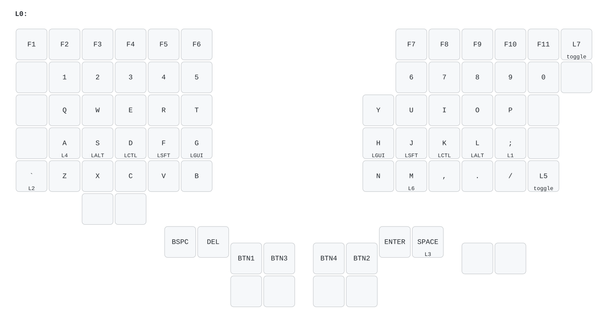
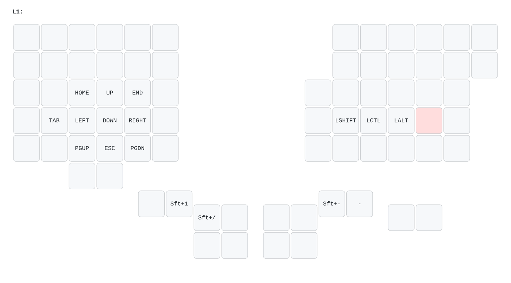
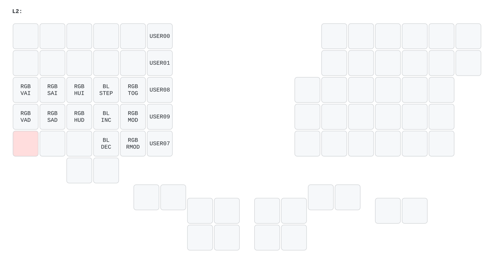
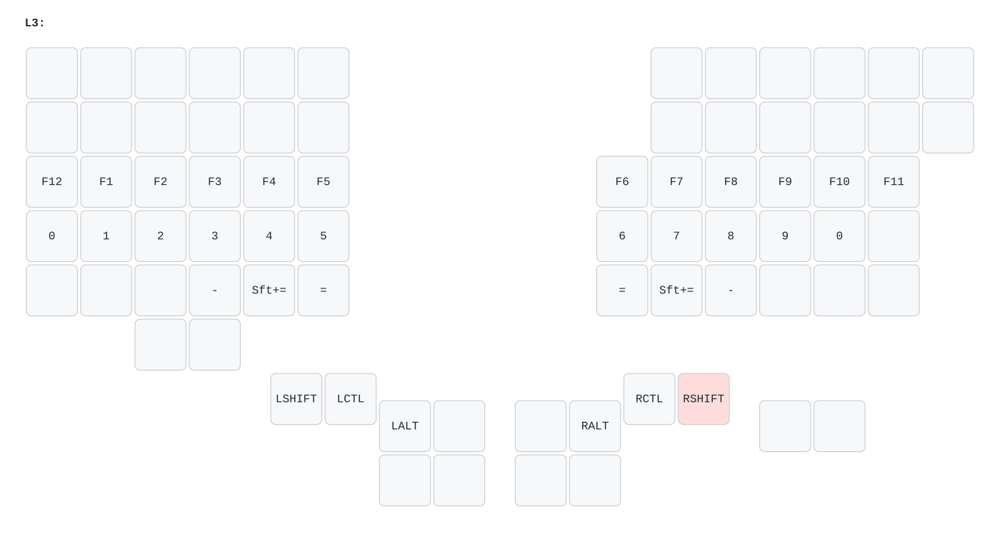
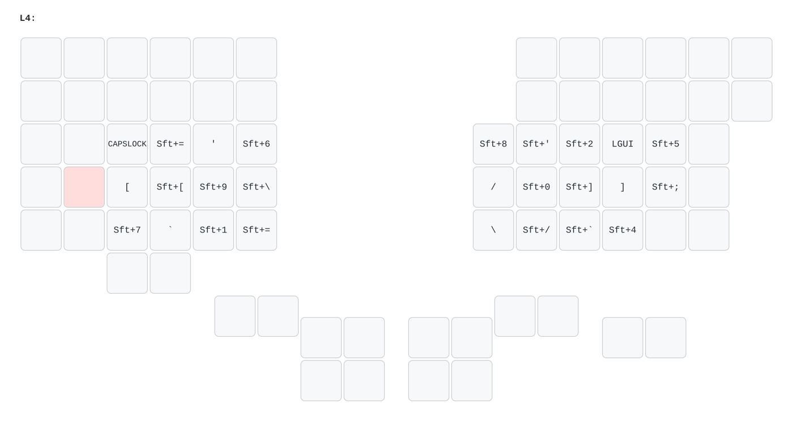
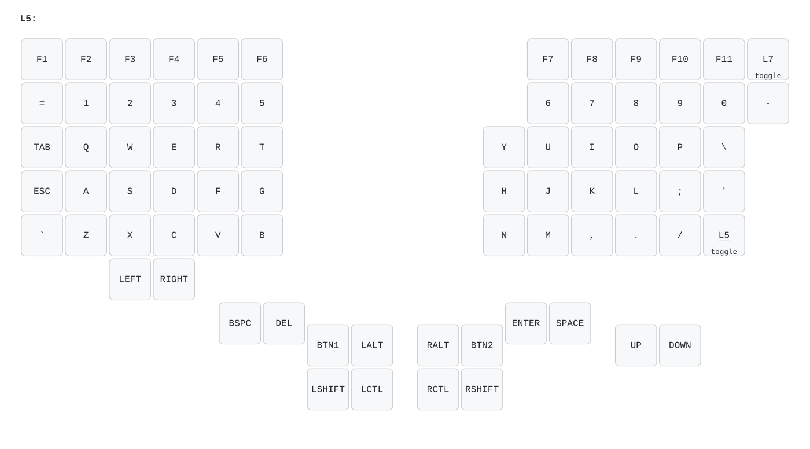
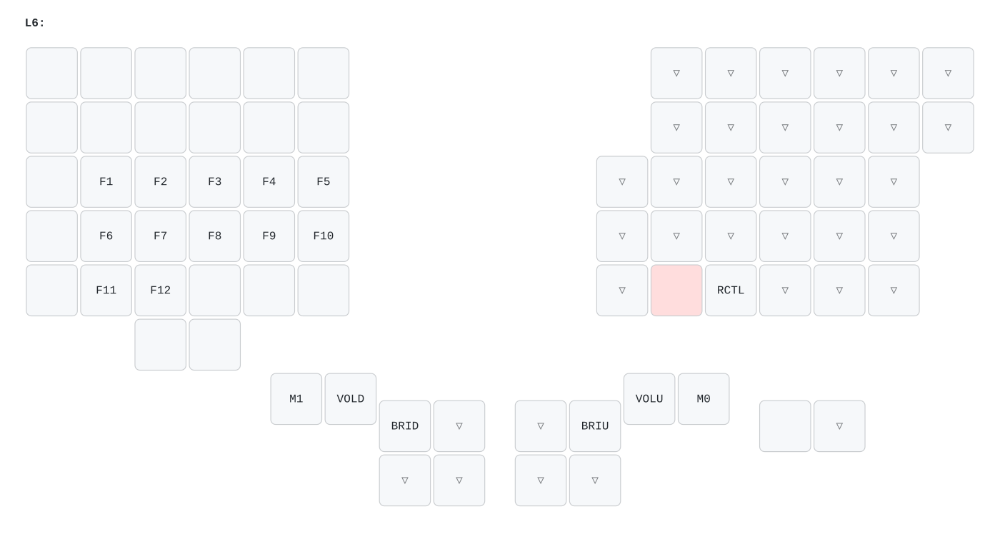
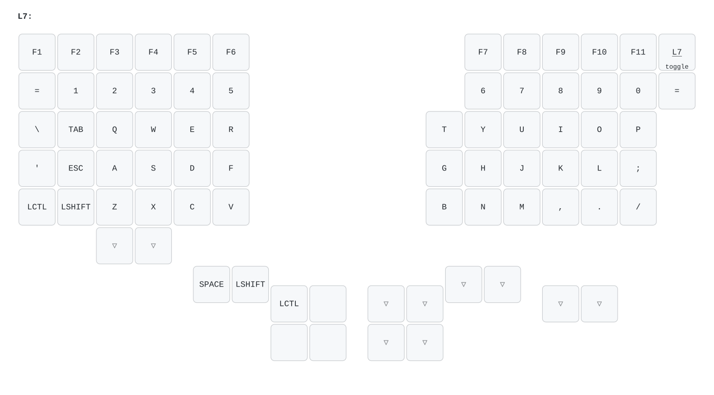
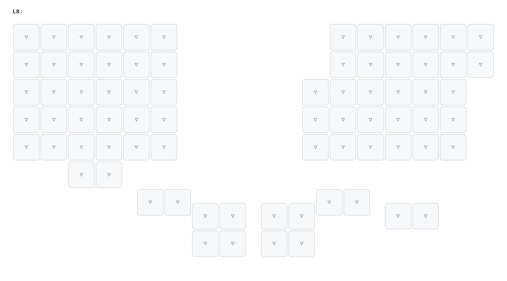

# Cyboard Imprint keymap

Pictures of every layer of `imprint_vial_latest.vil` (the 2-key bottom row, function row variant). Layer numbers match Vial: `L0` is the base layer, `LT(n)` keys and `MO`/`TG` switch to layer `Ln`. Pink keys are the ones you hold to reach that layer.

Regenerate with `imprint/keymap-images/generate.sh` after exporting a new `.vil` over `imprint_vial_latest.vil`. The other `.vil` files in this repo (`imprint_via_*`, `plank`) are not drawn.

## L0

## L1

## L2

## L3

## L4

## L5

## L6

## L7

## L8

## L9

